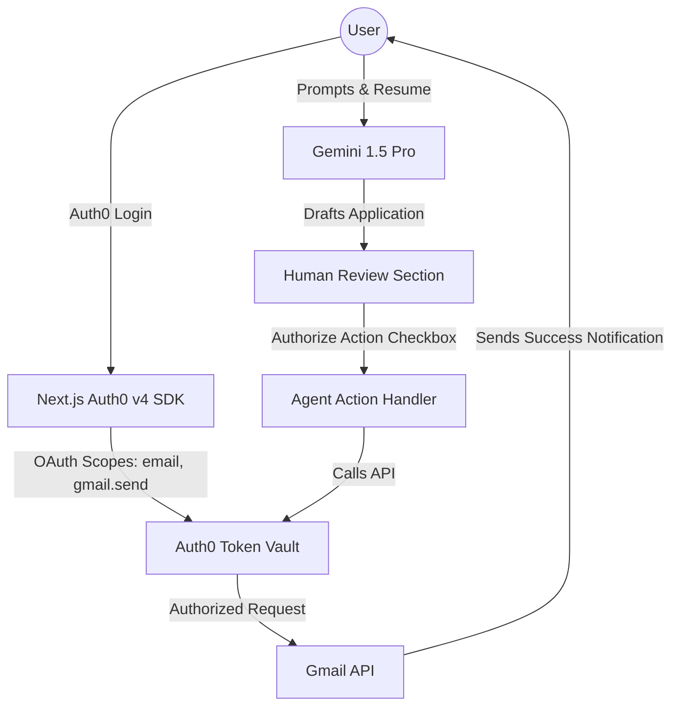

# 🚀 ApplyAgent: "Authorized to Act"

**ApplyAgent** is an AI-powered job application assistant that solves the "trust gap" in AI automation. By leveraging **Auth0 v4** and the **Auth0 Token Vault**, it creates a secure, zero-trust environment where an AI agent can act on your behalf without ever seeing your permanent credentials.

---

## 🛠️ The Architecture: How It Works

Traditional AI agents struggle because they either:
1.  **Lack authority**: They can only "research" but not "do".
2.  **Lack security**: You have to hand over raw API keys.

**ApplyAgent** uses the "Authorized to Act" pattern:
- **Identity Foundation**: Securely identifies the user via **Auth0**.
- **Ephemeral Authority**: The user grants a "Token of Authority" (Scoped OAuth tokens).
- **Secure Execution**: Using the **Auth0 Token Vault**, the AI Agent sends Gmails and interacts with LinkedIn APIs using short-lived, handled tokens — **zero secrets leaked to the AI.**



---

## ✨ Key Features

- **Auth0 Step-Up Auth**: High-stakes actions (like final submission) ensure the human is in the driver's seat.
- **Human-in-the-Loop (HITL)**: An interactive review hub where you refine the agent's tone and strategy before any email is sent.
- **Agentic Analysis**: Deep-fit analysis comparing job descriptions to your resume with AI-driven scoring.
- **Full Transparency**: Real-time console logs showing exactly what the agent is "thinking" and "planning".
- **Mission Accomplished**: A premium, celebratory UI implementation providing definitive feedback on completion.

---

## 🚀 Getting Started

### 1. Prerequisites
- Auth0 Account with an **Application** configured for **Next.js**.
- **Google Generative AI** (Gemini) API Key.
- Node.js 20+ and Next.js 16 (Turbopack).

### 2. Environment Variables (.env.local)

```bash
AUTH0_SECRET='your_32_byte_secret'
AUTH0_BASE_URL='http://localhost:3000'
AUTH0_DOMAIN='your_auth0_domain'
AUTH0_ISSUER_BASE_URL='https://your_auth0_domain'
AUTH0_CLIENT_ID='your_client_id'
AUTH0_CLIENT_SECRET='your_client_secret'
AUTH0_SCOPE="openid profile email https://www.googleapis.com/auth/gmail.send"

GOOGLE_GENERATIVE_AI_API_KEY='your_gemini_api_key'
```

### 3. Setup
```bash
npm install
npm run dev
```

---

## 🏆 Hackathon Alignment

This project specifically targets the following judging criteria:
- **Security Model**: Zero-trust pattern via Token Vault.
- **User Control**: Mandatory "Authorize to Act" checkbox for high-stakes actions.
- **Technical Execution**: Seamless integration with Next.js 16 and Auth0 v4 proxy conventions.
- **Design Experience**: Premium dark-mode UI with vibrant emerald flows and smooth Framer Motion animations.

---

## 👨‍💻 Implementation Details

- **Framework**: [Next.js 16 (Turbopack)](https://nextjs.org/)
- **Authorization**: [@auth0/nextjs-auth0 v4](https://auth0.com/)
- **Agent Orchestration**: [AI SDK](https://sdk.vercel.ai/)
- **Styling**: [Tailwind CSS 4](https://tailwindcss.com/)
- **Animations**: [Framer Motion](https://www.framer.com/motion/)

---

*Built for the Auth0 "Authorized to Act" Hackathon.*
